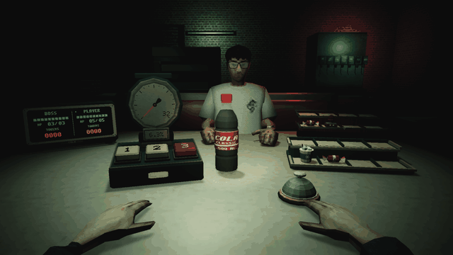
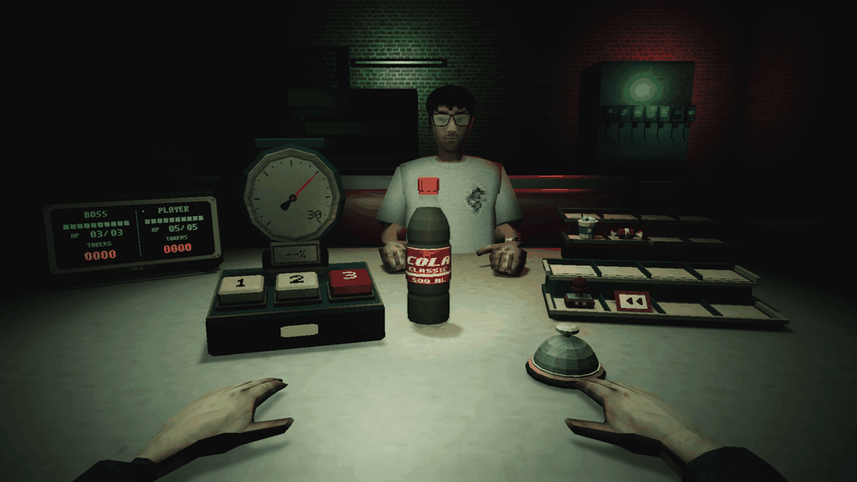

**CODEX를 사용해 개발한 프로젝트입니다.**

PS1풍 피자리아에서 상대와 번갈아 콜라를 흔드는 싱글 플레이 턴제 전략 게임. 
세게 흔들수록 보상은 커지지만, 내 차례에 터지면 피해를 받습니다.

**Windows · WebGL | 한국어 포함 10개 언어**

## 게임

- 강도 3단계로 위험과 보상을 선택
- 토큰으로 아이템을 주문해 압력·차례·피해를 조절
- 양쪽 합산 3회 폭발마다 능력 선택
- **5단계 · 아이템 19종 · 능력 17종 · 업적 26개**

<table>
  <tr>
    <td width="50%"></td>
    <td width="50%"></td>
  </tr>
</table>

## 조작

| 입력 | 동작 |
| :--- | :--- |
| `1` / `2` / `3` | 강도 선택 |
| `Space` / 콜라병 클릭 | 흔들기 |
| 마우스 올리기 | 정보 확인 |
| 왼쪽 클릭 | 아이템 사용 / 벨 주문 |
| 내 아이템 오른쪽 클릭 | 반납하고 토큰 1개 획득 |
| `Tab` / `Esc` | 능력·업적 / 설정 |

## 실행

- **웹:** [itch.io](https://myidmm64.itch.io/just-shake)에서 **Run game**
- **Windows:** ZIP 전체 압축 해제 후 `JUST SHAKE.exe` 실행
- **개발:** Unity **6000.6.4f1** → `Assets/Scenes/MainScene.unity` → Play

[게임 규칙](Docs/Gameplay) · [확률 시스템](Docs/ProbabilitySystem.md) · [빌드·배포](Docs/BuildAndItch.md)

크레딧

- 개발: [myidmm64](https://github.com/myidmm64)
- 음악: Bleak Terminal — Ruskerdax · CC0 ([출처](References/BGM_Candidates/LICENSES.md))
- 배경: [Pizzeria_PSX — elbolilloduro](https://elbolilloduro.itch.io/pizzeria-psx)
- 캐릭터: [Simple Character PSX Asset — JashiPSX](https://jashi-psx.itch.io/simple-character-psx-asset)
- 팔: [FPS Arms PSX Style — cemcakirca](https://cemcakirca.itch.io/fps-arms-psx-style)
- 글꼴: [Noto CJK](https://github.com/notofonts/noto-cjk), [Gowun Batang](https://github.com/google/fonts/tree/main/ofl/gowunbatang) · SIL OFL 1.1

